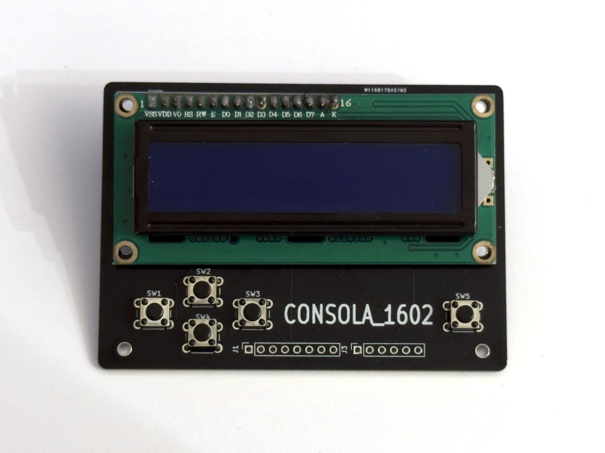
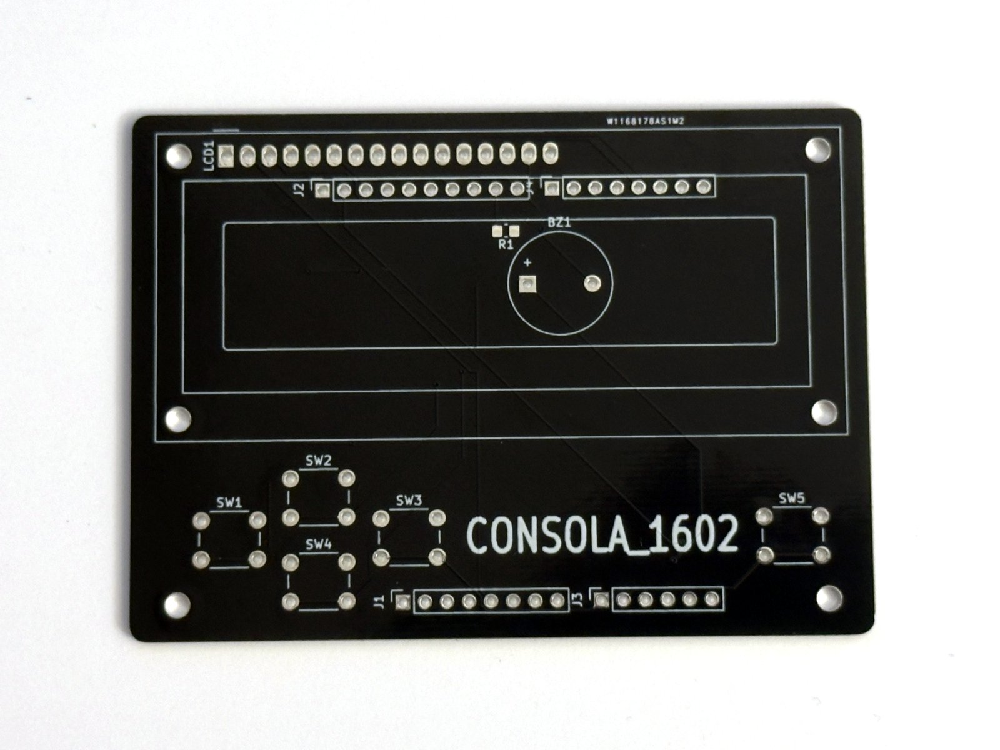
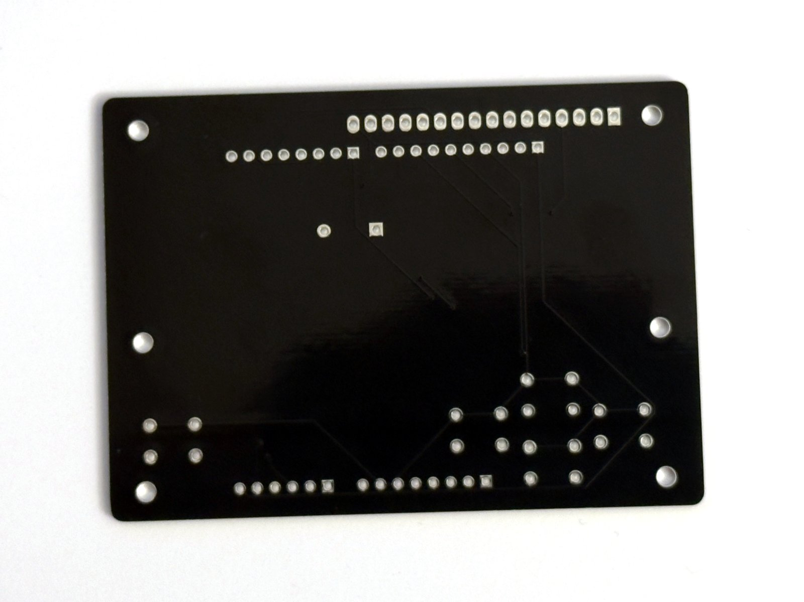
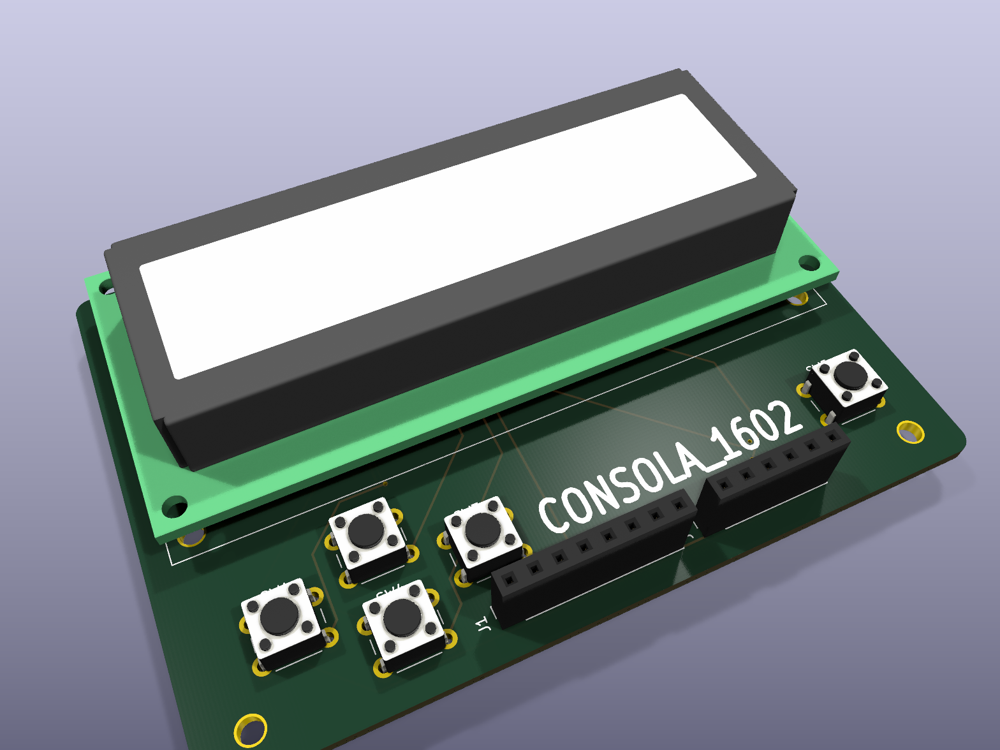
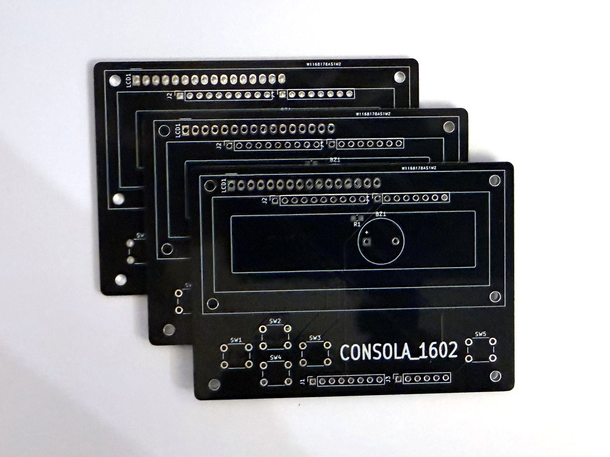
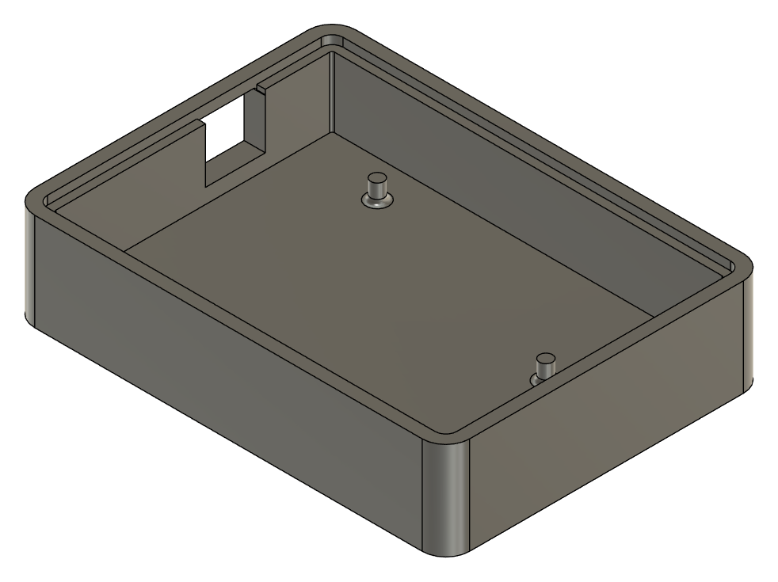

# Consola 1602 · v2


> La segunda versión de la [Consola 1602](https://github.com/zoraizmahmood/Consola-1602): el mismo firmware, pero ahora sobre una **PCB propia** diseñada en KiCad y fabricada por **PCBWay**. Adiós a la protoboard y a los cables sueltos.

<p align="center">
  
</p>

La v1 era un Arduino Uno, un LCD de 16x2, cinco botones y un zumbador unidos con cables dupont. Funcionaba, pero cualquier golpe soltaba un cable y no había forma de meterla en una caja decente. La v2 convierte todo ese cableado en un **shield** que se enchufa directamente encima del Arduino Uno: un único bloque compacto que entra en una carcasa a medida.

---

## Qué cambia respecto a la v1

| | v1 | v2 |
|---|---|---|
| Montaje | Protoboard y cables dupont | Shield PCB de dos capas que se enchufa al Uno |
| Contraste del LCD | Potenciómetro de 10 kΩ | Sin potenciómetro: V0 conectado a D8 |
| Zumbador | D8 | A2 |
| Resistencia de la retro | 220 Ω de inserción | R1 SMD 0805 (ver [lo que cambiaría](#mi-experiencia-con-pcbway)) |
| Carcasa | Pensada para el Uno suelto | Nueva, a medida de la PCB |
| Firmware | v1.1 | v2.0 (mismas aplicaciones, pines adaptados) |

Todas las aplicaciones de la v1 siguen ahí: reloj con dígitos grandes, Snake, Dino, Simon, test de reflejos, Pomodoro, notas, diagnóstico del sistema y ajustes en EEPROM. La documentación completa del firmware y su arquitectura está en el [repositorio de la v1](https://github.com/zoraizmahmood/Consola-1602#arquitectura).

---

## La placa

<p align="center">
  
  
</p>
<p align="center"><sub>La placa tal como llegó de PCBWay: máscara negra y serigrafía blanca. Cara superior a la izquierda, inferior a la derecha.</sub></p>

<p align="center">
  
</p>
<p align="center"><sub>El mismo diseño renderizado en KiCad antes de mandarlo a fabricar.</sub></p>

| Característica      | Valor                          |
|---------------------|--------------------------------|
| Tamaño              | 85,9 × 61,9 mm                 |
| Capas               | 2                              |
| Grosor              | 1,6 mm                         |
| Pista mínima        | 0,25 mm                        |
| Separación mínima   | 0,2 mm                         |
| Vías                | 9                              |
| Herramienta         | KiCad 10                       |
| Fabricante          | [PCBWay](https://www.pcbway.com) |

Los cinco botones forman una cruceta a la izquierda (`◄` `▲` `▼` `►`) y el `OK` queda solo a la derecha, como en un mando. El LCD ocupa toda la mitad superior y los conectores del Arduino quedan debajo, de modo que la placa se monta directamente encima del Uno.

### Archivos

| Ruta | Qué es |
|------|--------|
| [`hardware/pcb/placa.kicad_pro`](hardware/pcb/placa.kicad_pro) | Proyecto de KiCad |
| [`hardware/pcb/placa.kicad_sch`](hardware/pcb/placa.kicad_sch) | Esquema |
| [`hardware/pcb/placa.kicad_pcb`](hardware/pcb/placa.kicad_pcb) | Diseño de la placa |
| [`hardware/pcb/gerbers/`](hardware/pcb/gerbers/) | Gerber y taladros sueltos |
| [`hardware/pcb/gerbers-pcbway.zip`](hardware/pcb/gerbers-pcbway.zip) | El ZIP exacto que se subió a PCBWay |
| [`assets/esquema.pdf`](assets/esquema.pdf) | Esquema en PDF, para verlo sin KiCad |

### Pedir tu propia placa

1. Descarga [`gerbers-pcbway.zip`](hardware/pcb/gerbers-pcbway.zip).
2. Súbelo en el presupuesto rápido de PCBWay (o de cualquier otro fabricante: son Gerber estándar).
3. Las opciones por defecto valen: 2 capas, 1,6 mm, FR-4. El color de la máscara es a tu gusto.

---

## Mi experiencia con PCBWay

Esta versión existe gracias a que **PCBWay patrocinó la fabricación de las placas**. Lo dejo claro desde el principio: no he pagado las PCB. Lo que cuento aquí es mi experiencia real, incluido lo que cambiaría (que es culpa mía, no de ellos).

### Cronología

| Fecha        | Qué pasó                                                              |
|--------------|-----------------------------------------------------------------------|
| 13 de agosto | PCBWay se pone en contacto conmigo tras ver la v1                     |
| 17 de agosto | Diseño terminado en KiCad y Gerber listos                             |
| 18 de agosto | Pedido registrado                                                     |
| 19 de agosto | Placas fabricadas y enviadas                                          |

**Del primer correo a tener los Gerber pasaron solo cuatro días**, y desde que se registró el pedido hasta que salió de fábrica, **poco más de un día**.

**Diseñar la primera PCB.** Hasta ahora todo lo había montado en protoboard, así que pasar a KiCad fue empezar de cero: esquema, asignar huellas, colocar componentes y rutar pistas. Lo más difícil no fue el rutado, sino decidir dónde iba cada cosa para que la placa encajara sobre el Arduino Uno y a la vez quedara cómoda en la mano.

**El pedido.** Subí el ZIP con los Gerber y del resto se encargó su equipo de atención al cliente. Elegí FR-4 de dos capas, 1,6 mm y **máscara negra con serigrafía blanca**. PCBWay se hizo cargo también del IVA, así que el paquete llegó a Barcelona sin sorpresas en la aduana.

**La calidad: excelente.** El paquete llegó **perfectamente empaquetado** y las placas, impecables: la serigrafía se lee nítida hasta en los textos más pequeños, la máscara negra está bien alineada con los pads y todos los taladros encajan con los componentes. El acabado negro queda muy bien; parece un producto de verdad, no un prototipo.

**Lo que cambiaría.** La resistencia de la retroiluminación (R1). En el diseño elegí una huella **SMD 0805**, una de esas resistencias diminutas que se sueldan con estación de aire caliente o con mucho pulso, en vez de una resistencia normal de patillas. Es la única pieza SMD de la placa: todo lo demás es de inserción y se suelda sin problema con un soldador normal. En la próxima versión usaré una resistencia de inserción (huella `R_Axial_DIN0207`), para que toda la placa se pueda montar con un soldador básico. Si te fijas en los Gerber (`placa-F_Cu.gbr`) o en la foto de la cara superior, son los dos pads pequeños marcados como `R1` junto al zumbador.

**En resumen:** pasar de la protoboard a una PCB fabricada ha sido el salto más grande del proyecto. Ver tu propio diseño convertido en una placa real, con tu nombre en la serigrafía, es otra cosa. Si estás pensando en hacer tu primera PCB, hazla.

<p align="center">
  
</p>
<p align="center"><sub>El lote recién sacado del paquete.</sub></p>

---

## Materiales

| Componente                              | Ref.      | Cantidad |
|-----------------------------------------|-----------|----------|
| PCB Consola 1602 v2                     | —         | 1        |
| Arduino Uno R3                          | —         | 1        |
| LCD 16x2 con HD44780 (WC1602A o similar)| LCD1      | 1        |
| Pulsador táctil 6×6 mm de inserción     | SW1–SW5   | 5        |
| Zumbador activo de 5 V, 12 mm           | BZ1       | 1        |
| Resistencia 220 Ω, SMD 0805 ⚠️          | R1        | 1        |
| Tira de pines de 2,54 mm 1x8            | J1, J4    | 2        |
| Tira de pines de 2,54 mm 1x10           | J2        | 1        |
| Tira de pines de 2,54 mm 1x6            | J3        | 1        |

Ya no hace falta el potenciómetro de 10 kΩ ni la protoboard.

> ⚠️ **R1 es SMD (0805)**, la única pieza de montaje superficial. Para soldarla viene bien una estación de aire caliente, o un soldador de punta fina con pinzas y flux.

---

## Conexiones

En la v2 el cableado lo fija la placa, pero conviene tenerlo a mano para depurar:

| Señal                | Pin del Uno | En la PCB |
|----------------------|-------------|-----------|
| LCD `RS`             | D12         | LCD1-4    |
| LCD `E`              | D11         | LCD1-6    |
| LCD `D4–D7`          | D5, D4, D3, D2 | LCD1-11…14 |
| LCD `V0` (contraste) | D8          | LCD1-3    |
| LCD `A` (retro)      | D9 a través de R1 | LCD1-15 |
| `▲`                  | D6          | SW2       |
| `▼`                  | D7          | SW4       |
| `◄`                  | D10         | SW1       |
| `►`                  | A0          | SW3       |
| `OK`                 | A1          | SW5       |
| Zumbador             | A2          | BZ1       |

**Sobre el contraste:** la v1 usaba un potenciómetro en `V0`. En la placa ese pin va a D8 y el firmware lo pone a `LOW`, que equivale a contraste máximo y en los LCD de 5 V se lee bien. Así la placa se queda sin una pieza y sin un ajuste que hacer a mano.

Los pines **A4** y **A5** siguen libres para añadir un RTC DS3231.

---

## Carcasa

La carcasa de la v2 está rediseñada a medida de la PCB: una bandeja de 91,75 × 67,75 × 20,6 mm con esquinas redondeadas, un reborde interior en el borde superior, dos tetones de fijación en el fondo y una ventana lateral para los conectores.

<p align="center">
  
</p>

| Archivo | Formato | Para qué sirve |
|---------|---------|----------------|
| [`hardware/carcasa/carcasa-v2.step`](hardware/carcasa/carcasa-v2.step) | STEP | Sólido editable en cualquier CAD (Fusion 360, FreeCAD, Onshape…) |
| [`hardware/carcasa/carcasa-v2.3mf`](hardware/carcasa/carcasa-v2.3mf) | 3MF | Listo para abrir en el laminador (Bambu Studio, PrusaSlicer, Cura…) |

### Ajustes de impresión

| Parámetro          | Valor        |
|--------------------|--------------|
| Material           | PLA          |
| Altura de capa     | 0,2 mm       |
| Relleno            | 20 %         |
| Soportes           | No           |
| Perímetros         | 3            |

---

## Cargar el firmware

Solo hace falta la librería `LiquidCrystal`, que viene incluida en el IDE de Arduino.

```bash
git clone https://github.com/zoraizmahmood/Consola-1602-v2.git
cd Consola-1602-v2

arduino-cli compile --fqbn arduino:avr:uno .
arduino-cli upload  --fqbn arduino:avr:uno -p /dev/ttyACM0 .
```

También puedes abrir `Consola-1602-v2.ino` en el IDE de Arduino y subirlo con `Ctrl+U`.

| Recurso                  | Uso      | Máximo del Uno | Ocupación |
|--------------------------|----------|----------------|-----------|
| Memoria de programa      | 15 238 B | 32 256 B       | 47 %      |
| RAM (variables globales) | 622 B    | 2 048 B        | 30 %      |

El [`diagram.json`](diagram.json) de [Wokwi](https://wokwi.com) está actualizado al cableado de la v2, así que puedes probar el firmware en el navegador antes de soldar nada.

---

## Estructura del proyecto

```
Consola-1602-v2/
├── Consola-1602-v2.ino      # Firmware adaptado a la PCB
├── diagram.json             # Cableado para el simulador de Wokwi
├── wokwi.toml
├── hardware/
│   ├── pcb/
│   │   ├── placa.kicad_pro  # Proyecto de KiCad
│   │   ├── placa.kicad_sch  # Esquema
│   │   ├── placa.kicad_pcb  # Diseño de la placa
│   │   ├── gerbers/         # Gerber y taladros
│   │   └── gerbers-pcbway.zip
│   └── carcasa/
│       ├── carcasa-v2.step  # Sólido editable
│       └── carcasa-v2.3mf   # Listo para laminar
├── assets/                  # Fotos, renders y esquema en PDF
└── .github/workflows/
    └── build.yml            # Compilación automática para arduino:avr:uno
```

---

## Agradecimientos

A [PCBWay](https://www.pcbway.com) por patrocinar la fabricación de las placas de esta versión.

## Autor

Creado por [zoraizmahmood](https://github.com/zoraizmahmood).

## Licencia

El firmware, bajo licencia [MIT](LICENSE). El hardware de `hardware/` (PCB y carcasa), bajo [CC BY 4.0](https://creativecommons.org/licenses/by/4.0/deed.es).
