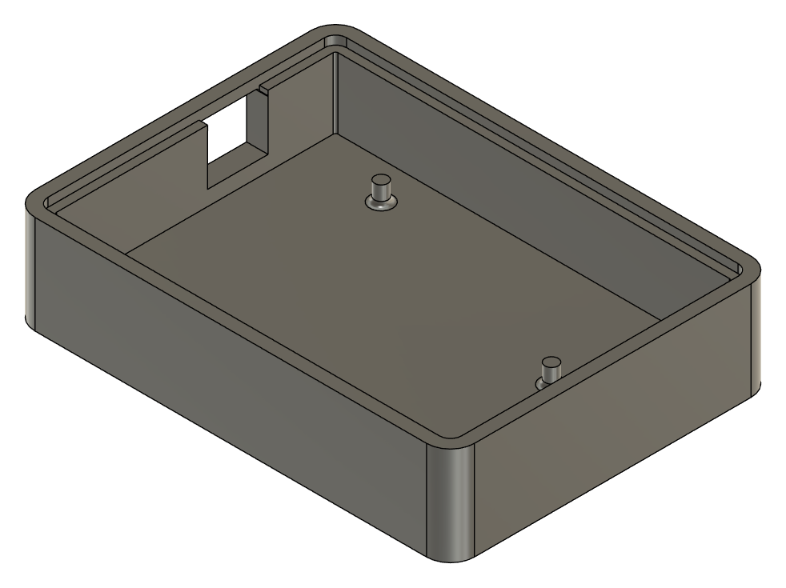

# Carcasa v2

Bandeja a medida de la PCB de la Consola 1602 v2.

  

| Archivo            | Formato | Para qué sirve                                          |
|--------------------|---------|---------------------------------------------------------|
| `carcasa-v2.step`  | STEP    | Sólido editable en cualquier CAD                        |
| `carcasa-v2.3mf`   | 3MF     | Listo para abrir en el laminador e imprimir             |

Medidas exteriores: 91,75 × 67,75 × 20,6 mm.
